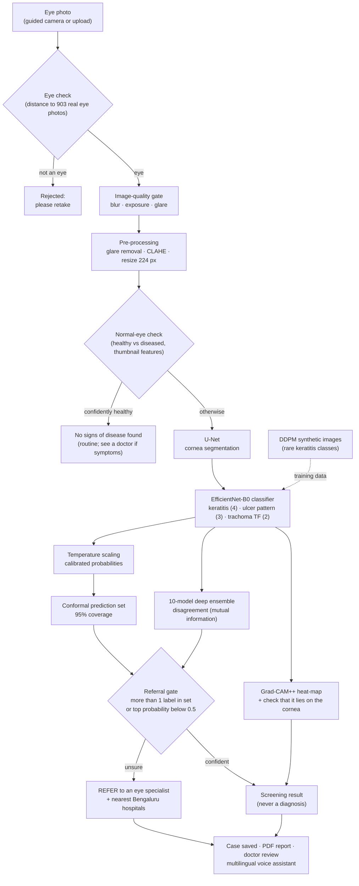

# OcuLens-AI: An Explainable, Multilingual AI Platform for Anterior-Eye Disease Screening

OcuLens-AI is an explainable AI prototype that screens front-of-eye photos for keratitis, corneal ulcers and
trachoma, flags uncertain cases for specialist referral, and supports patients with a five-language voice
assistant, home self-checks, nearby-hospital booking, eye-drop reminders and referral follow-up. It runs offline
on an ordinary laptop.

> Research prototype for a capstone project: a screening and decision-support tool only, not a medical device.
> It does not replace an ophthalmologist's diagnosis.

**Team:** Syed Mohammed Yaseen, Mohammed Ayaan, Arfath Khan · Capstone 2026

## What it does

- **Screening:** EfficientNet-B0 classifiers (keratitis type, corneal-ulcer pattern, trachoma TF), U-Net cornea
  segmentation, diffusion-augmented training for rare keratitis classes, calibrated confidence, conformal
  prediction sets, 10-model ensemble uncertainty, Grad-CAM++ heat-maps, eye / image-quality gates, a normal-eye
  check (reports "no signs of disease" only when confident: 0.24% of diseased test eyes called normal), and a referral
  rule that never reports an uncertain case as normal.
- **Doctor portal:** layer-by-layer screening, guided two-eye camera capture, review queue and recommendations,
  PDF reports, appointment calendar per doctor, eye-drop schedules with adherence, referral follow-up
  ("did the patient reach the specialist?"), evaluation dashboard.
- **Patient portal:** self-checks, plain-language results, symptom diary, at-home vision test (tumbling-E chart,
  Amsler grid), eye-drop reminders, nearest-hospital booking (location / area / pincode, map, directions,
  earliest slot, appointment pass with QR code), eye-health lessons, emergency help.
- **AI assistant:** answers by text or voice in English, Hindi, Kannada, Tamil and Telugu with natural Indian
  voices; never diagnoses or names medicines; red-flag symptoms get urgent advice. Works offline from a grounded
  knowledge base, or with the Claude API when a key is configured.

Held-out balanced accuracy: trachoma 0.81; corneal-ulcer pattern 0.68 (with the cornea mask as input; the portal's
image-only model 0.63); infectious keratitis 0.42 on average across four seeds (best model 0.488, four-model
ensemble 0.474). Test sets are small and single-site: first baselines, not clinical claims.

## Running the portal

```
pip install -r requirements.txt
python -m streamlit run portal/app.py        # then open http://localhost:8501
```

Demo logins: doctor `dr.yaseen / doctor123`, patient `ravi / patient123`, admin `admin / admin123`.

Not in this repository (by design): the datasets (public, but large and licence-bound), trained model weights,
the portal database and patient photos. See `scripts/` and `src/oculens/training/` to rebuild them.
Translations into Hindi, Kannada, Tamil and Telugu are machine-made (Meta NLLB-200) plus hand-written interface
labels, and still need review by native speakers.

## Model block diagram



| Block | Model / method | Role |
|---|---|---|
| Eye check | Feature distance to 903 reference eye photos | Refuses images that are not an eye before any prediction |
| Quality gate | Blur, exposure, glare and contrast tests | Asks for a retake instead of judging a poor photo |
| Normal-eye check | Logistic head on EfficientNet features, resolution-equalised thumbnails | Reports a healthy eye only above a strict threshold (test: 89.9% of healthy eyes, 0.24% of diseased eyes called normal) |
| Segmentation | U-Net | Outlines the cornea, the region these diseases affect |
| Classifier | EfficientNet-B0 (ImageNet pre-trained), one per task | Scores each condition; keratitis model trained with diffusion (DDPM) images of rare classes |
| Calibration | Temperature scaling | Makes the confidence honest |
| Conformal prediction | Split conformal, alpha = 0.05 | Lists every condition the model cannot rule out (95% coverage) |
| Uncertainty | 10-model deep ensemble, mutual information | Flags images the models disagree on |
| Referral gate | Prediction-set size, confidence | Uncertain cases are referred, never reported as normal |
| Explanation | Grad-CAM++ with a cornea-region check | Shows where the model looked |

## Pipeline

```
image -> quality check -> enhancement (glare removal, CLAHE) -> classifier (calibrated)
      -> conformal prediction set / referral -> Grad-CAM++ + anatomy check
      -> triage (safety rules first) -> structured report -> patient explanation (guardrailed)
```

## Layout

```
configs/            default.yaml (paths, thresholds, tasks), triage_rules.yaml (clinical rules)
src/oculens/
  data/             manifest builder, leakage-free splits, PyTorch dataset
  quality/          blur / exposure / glare / contrast gate with recapture prompts
  preprocessing/    CLAHE, specular reflection removal, transforms
  models/           timm classifier, U-Net segmentation baseline, segmenter wrapper
  training/         classifier + segmentation training, evaluation (subgroups, referral), focal loss, metrics
  uncertainty/      temperature scaling, split conformal prediction, MC dropout, deep ensembles
  generative/       conditional DDPM (rare classes), CycleGAN harmonisation, FID + TSTR checks
  followup/         alignment, change detection, Siamese change model, schedules, post-op checks
  explain/          Grad-CAM / Grad-CAM++, attention-in-region check
  triage/           rule engine: routine / soon / refer / urgent
  assistant/        findings schema, guardrails, LLM explanation with offline template fallback
  pipeline.py       end-to-end screening of one image
backend/app/        FastAPI service + single-page web UI
scripts/            build_manifest, make_splits, train, screen_image
tests/              unit tests (no dataset needed)
datasets/           downloaded data (not in git) - see datasets/DATA_LICENSES.md
```

## Setup

```bash
python -m venv .venv
.venv\Scripts\activate            # Windows
pip install -r requirements.txt
pytest
```

## Typical workflow

```bash
python scripts/build_manifest.py                 # index every image in datasets/
python scripts/make_splits.py                    # patient-level train/val/test per task
python scripts/train.py --task keratitis --epochs 2 --limit 64   # quick CPU smoke run
python scripts/train.py --task keratitis         # full run (GPU recommended)
uvicorn backend.app.main:app --reload            # web app at http://127.0.0.1:8000  (doctor dashboard: /dashboard)
```

More commands:

```bash
python scripts/cache_images.py keratitis                       # 512 px cache, much faster training
python -m oculens.training.evaluate --task keratitis          # metrics, conformal coverage, referral effect, subgroups
python scripts/train.py --task keratitis --seed 1             # repeat with seeds 1-5 for a deep ensemble
python -m oculens.training.train_segmentation --target cornea # U-Net; the pipeline then uses it for the anatomy check
python -m oculens.explain.evaluate --task ulcer_pattern --mask cornea
python -m oculens.generative.train_ddpm --task keratitis --size 64 --epochs 200   # synthetic images, training split only
python -m oculens.followup.train_change --pairs data/followup_pairs.csv           # needs clinician-labelled pairs
python scripts/export_onnx.py --task keratitis                # ONNX export + CPU latency
python scripts/train.py --task keratitis --variant mask_input          # RQ1 options: mask_input | region_crop | multitask
python scripts/train.py --task keratitis --resume                      # continue an interrupted run (early stopping is on by default)
python scripts/train.py --task keratitis --synthetic                   # add DDPM images (training split only)
python -m oculens.generative.train_cyclegan --task keratitis --domain-a ZEH --domain-b AGEH --allow-test-domain
python scripts/predict_masks.py keratitis                              # U-Net masks for datasets without masks
bash scripts/dry_run_all.sh                                            # 1-epoch check of every path, outputs in experiments/dryrun
bash scripts/run_full_plan.sh                                          # all experiments in order, logged to experiments/logs
```

Tasks are defined in `configs/default.yaml`:

| Task | Data | Classes | Split |
|---|---|---|---|
| `keratitis` | Infectious Keratitis (2 hospitals) | BK, FK, HSK, other | train ZEH, test AGEH (cross-site) |
| `ulcer_pattern` | SUSTech-SYSU | point-like, mixed, flaky | grouped |
| `eye_disease_prototype` | web-sourced set | 5 classes | grouped - prototype only |
| `trachoma_tf` | trachoma photos | TF yes / no | grouped |

The Nuclear Cataract download has **no LOCS III grade labels**, so it is not a supervised task yet.

## Patient assistant

`src/oculens/assistant/llm.py` sends only the structured findings (never the image) to the
Anthropic API when credentials are configured (`ANTHROPIC_API_KEY`). Without credentials it uses
a fixed English template. Both paths go through `guardrails.py` (hedged wording, no doses,
urgent instruction, disclaimer).

## Clinical rules

`configs/triage_rules.yaml` must be reviewed and signed off by the clinical advisor before any real use.
